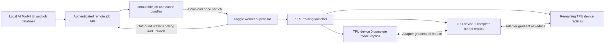

# Kaggle TPU worker implementation plan

Build a remote AI Toolkit training worker for Qwen Image 2.1 with ConvRot INT8 weights. Run one complete model replica on every available TPU device in a single Kaggle VM, distribute training examples between replicas, and synchronize adapter gradients. Model weights, gradients, and optimizer state remain replicated; model and optimizer sharding are deferred.

The first supported workload is frozen-base LoRA training with cached conditioning and image latents. This is a planning assumption: other adapter types and training modes must be admitted through explicit capability checks rather than silently translated. The user's current CUDA run uses under 13 GB, but TPU fit and throughput are acceptance tests, not established facts.

This is a substantial backend and remote execution change. The highest uncertainty is ConvRot backward memory and Qwen attention under XLA. Prove a full training step fits one device before building the complete remote integration. No implementation or deployment is part of this document.

## Architecture

The Kaggle notebook starts a foreground worker supervisor. The supervisor owns networking, heartbeat, artifact transfers, and the training subprocess. Training ranks communicate with it through bounded host-side queues and files; they do not make network requests inside compiled training steps. One rank publishes ordinary progress and checkpoint artifacts; all ranks contribute errors and participate in control decisions.

The local controller remains the owner of the SQLite database. Remote workers use a narrow authenticated API and never mount or copy the live database. A controller reachable only on the local LAN needs a user-configured HTTPS relay or reverse tunnel. Binding the controller to `0.0.0.0` supports LAN access but does not itself provide internet reachability. The notebook needs outbound internet access and a scoped worker token supplied through Kaggle Secrets. Actual exposure and deployment are later implementation steps.

## Current integration points

| Existing area | Required extension |
| --- | --- |
| `toolkit/util/convrot_quant.py` | Add explicit XLA dispatch while preserving existing CUDA and MPS behavior and checkpoint format. |
| `toolkit/util/comfy_quant_import.py` | Reuse ConvRot checkpoint decoding; normalize scale storage before device placement. |
| `extensions_built_in/diffusion_models/qwen_image_2/` | Reuse model, conditioning, reference-image, and flow-matching semantics; supply an XLA-compatible execution path. |
| `jobs/process/BaseSDTrainProcess.py`, `extensions_built_in/sd_trainer/SDTrainer.py` | Extract narrowly scoped reusable training operations where needed; avoid copying the full GPU trainer. |
| `toolkit/accelerator.py` | Audit global accelerator state and ensure the TPU runtime is owned by the correct replica, including threaded PJRT layouts. |
| `toolkit/data_loader.py`, `toolkit/dataloader_mixins.py` | Replace independent per-rank bucket shuffles with a shared deterministic global batch schedule for the TPU profile. |
| `extensions_built_in/sd_trainer/UITrainer.py`, `DiffusionTrainer.py`, `toolkit/ui_checkpoint.py` | Reuse status/checkpoint semantics through a transport-neutral reporting and control interface. |
| `ui/cron/actions/startJob.ts`, `processQueue.ts` | Dispatch local jobs as today and lease TPU jobs to remote workers without allocating local GPU slots. |
| `ui/prisma/schema.prisma`, job start/stop/save routes | Add execution target, worker, attempt, lease, and remote artifact metadata; remote jobs have no local training PID. |
| `ui/src/app/jobs/new/trainingCapabilities.ts` | Validate TPU capabilities and explain incompatible settings before submission. |

The existing local launcher sets CUDA environment variables and injects a local SQLite path. The shared trainer also contains CUDA memory management and compilation paths. Pointing the current launcher at `xla` is insufficient.

## Phase 1 Establish the Kaggle runtime

Create `workers/kaggle_tpu/bootstrap.ipynb`, a pinned TPU dependency set, and a small capability probe. Install the project without pulling in CUDA-only dependencies. Make optional GPU imports lazy where necessary. Record the exact AI Toolkit commit and matching Python, PyTorch, PyTorch/XLA, and `libtpu` versions; select the version combination after testing on Kaggle, not from an unverified version guess.

The probe reports TPU generation, addressable device count, PJRT topology, per-device HBM, host RAM, disk capacity, INT8 dot support, and required attention support. It runs separately from the process that later launches replicas so an early device initialization cannot break spawning. The supervisor verifies that the launched world size equals the discovered device count.

Do not assume eight independent OS processes. PJRT documents threaded execution on TPU v2/v3; use the pinned runtime's supported launcher, such as `torch_xla.launch`, with runtime-discovered ordinals. Model state, random generators, accelerator objects, and device caches must be replica-safe. [PJRT documentation](https://docs.pytorch.org/xla/master/learn/pjrt.html)

Native INT8 capability depends on the hardware and runtime. For example, Google documents INT8 compute on v5e, but that does not identify the hardware assigned to a particular Kaggle notebook. Record capabilities from the actual session. [TPU v5e specifications](https://docs.cloud.google.com/tpu/docs/v5e)

**Exit condition:** the notebook launches a small computation on every discovered device, verifies collective communication, and emits a reproducible environment report without importing GPU-only packages.

## Phase 2 Implement the ConvRot XLA backend

Add an isolated backend, provisionally `toolkit/util/convrot_xla.py`, selected only for XLA tensors. Keep imports lazy and keep device-specific details out of checkpoint loading.

Preserve the existing operation contract:

1. Load the stored rotated INT8 weight codes, per-output-row FP32 scales, rotation group size, and bias. Preserve codes and scales without dequantizing and requantizing the checkpoint. Decode byte-view scale storage on CPU and use ordinary FP32 scale tensors on XLA; export the existing format.
2. Apply the same normalized regular Hadamard rotation to the input, with the same group size, dtype, and orientation as `rotate()`.
3. Compute activation scales in FP32 using the existing `act_qmax`. Preserve zero-row handling, rounding, and the existing integer range exactly as algorithmic requirements. Do not introduce new clipping or change the quantization scheme.
4. Multiply INT8 activations by INT8 weight codes with INT32 accumulation, apply row and column scales in the reference order, add bias, and cast to the requested output dtype.
5. Supply a custom straight-through backward for input gradients. Save compact weight codes and scales; reconstruct only the weight needed for the current backward operation and propagate through the rotation. The frozen base has no weight gradient. Preserve the CUDA backward's cast/scale ordering and keep ordinary autograd for the trainable LoRA branch. Reject trainable base weights or biases until explicitly supported.

Upstream PyTorch/XLA source contains a quantized matmul route with activation quantization and an INT8 dot with INT32 accumulation. Its activation-scale arithmetic and zero-row handling differ from this fork's ConvRot implementation. Use it as evidence of available primitives, not as a drop-in numerical replacement. Wrap the selected XLA dot primitive behind one version-checked adapter; any private API dependency must be explicit. [Upstream XLA quantized matmul source](https://github.com/pytorch/xla/blob/master/torch_xla/experimental/xla_quantized_matmul.py)

Validate the exact pinned wheel, since the older published quantized-operations table and current source do not describe identical capabilities. A W8A16 operation alone does not establish support for the required W8A8 forward and backward. [Published XLA quantized operations documentation](https://docs.pytorch.org/xla/release/r2.8/perf/quantized_ops.html)

The XLA compiler may retain or hoist dequantized weights despite a compact Python autograd context. Inspect compiled operations, buffer lifetimes, persistent device buffers, and peak memory after synchronized execution. Block checkpointing and an explicit recomputation boundary may be necessary to preserve memory savings. Do not claim a compact backward based only on `save_for_backward` contents.

Preserve behavior across gradient-checkpoint recomputation and the existing `requires_grad` dispatch: a recomputed training block must not accidentally use a different activation-quantization mode. Explicitly test checkpointed and uncheckpointed paths, zero inputs, shape padding, and LoRA gradients through both.

If the selected TPU runtime cannot execute the needed operation correctly, fail with a precise capability report. Do not silently switch the job to BF16, W8A16, CPU execution, or sharding. Fixes within this fork are in scope for implementation; changing external PyTorch/XLA code needs a separate explicit request.

**Exit condition:** a real Qwen-sized projection runs forward and backward on TPU with compact resident weights, finite gradients, documented numerical differences against the CUDA path, and no unintended CPU execution.

## Phase 3 Make one complete Qwen training replica fit

Add a focused TPU runner, provisionally `toolkit/tpu/train.py`, composed from the existing Qwen model, adapter construction, timestep sampling, flow-matching target, loss, and serialization code. Extract shared pure operations as necessary; do not create a second independently evolving copy of `SDTrainer`.

The first training profile uses a frozen ConvRot transformer, BF16 activations and LoRA parameters where supported, an explicit XLA-compatible AdamW configuration, gradient checkpointing, cached text conditioning, and cached image latents. Optimizer state precision and placement are explicit. Preserve the submitted objective and supported hyperparameters; reject incompatible optimizers, trainable encoders, pixel-decoding losses, full finetuning, layer swapping, or other unimplemented modes rather than ignoring settings.

Audit placement explicitly: `low_vram` currently affects CPU loading, and `OstrisLinear` only automatically repairs certain CUDA placements. Keep chunked host loading but place every training layer on its owning XLA device before execution. Avoid `.weight` access that materializes a dequantized base during wrapping or export. Validate or reject `low_vram`, layer streaming, offloading, full-weight ConvRot QAT, and GPU compilation options individually; a prequantized checkpoint is not a complete TPU configuration.

Export cache bundles locally using AI Toolkit's existing encoder and VAE paths. Include target latents, prompt embeddings, valid-token masks, negative/blank conditioning when required, and reference-image embeddings, slots, and latents for editing. Preserve `qwen_image_2_bucketed_refs_v2` cache identity and the model's reference-aware caption-dropout semantics. Fingerprint preprocessing, crop/resize policy, caption variants, model and encoder revisions, and dataset contents. Reject runtime augmentations that cannot be represented by the cache; do not freeze them silently.

Download each model and cache bundle once per VM. Map checkpoint tensors on the host and load incrementally to avoid a complete floating-point host copy per replica. Release staging tensors promptly and measure aggregate host RAM while all replicas load. The training process does not keep the text encoder or VAE on TPU. Initial sample previews run locally from uploaded adapter snapshots; any TPU sampling request is explicitly unsupported in this profile.

Use a bounded set of static image, text, and reference-layout buckets. Build token metadata on CPU, pad with correct masks, and move `.item()`/`.tolist()` decisions out of the compiled step. Preserve positional indices, reference visibility, and target-only loss when padding. Audit rotary embedding operations and provide equivalent real-valued arithmetic if the required XLA complex operations are unavailable.

Provide TPU-compatible block-causal attention with backward support. Start by validating the existing segmented attention semantics, then use a supported memory-efficient XLA attention implementation where needed. Measure at the user's actual resolution and reference layout: a dense attention score matrix can erase the savings from INT8 weights. Dense attention at a tiny resolution is only a correctness probe, not proof that the intended job fits.

**Exit condition:** the exact intended Qwen profile completes a sustained one-device run, including initial compilation, optimizer allocation, checkpoint save, and resume. Record peak HBM and host RAM, compile time, steady-state samples per second, and margin to device capacity. Target at least 10 percent HBM headroom; smaller margins require explicit reporting. If it does not fit, report the failing allocation and configuration without adding sharding.

## Phase 4 Use every TPU through data parallelism

Launch one logical replica per discovered TPU device. Each replica owns the complete frozen INT8 model, LoRA parameters, and optimizer state. Load identical initial adapter parameters from one CPU snapshot and verify matching values across replicas. Share only immutable host artifacts.

Implement synchronous replicated training using one explicit gradient-reduction owner. The initial design uses XLA collectives to average trainable adapter gradients after accumulation, then ordinary optimizer updates on each replica. Do not also enable DDP or an optimizer wrapper that performs a second reduction. Keep the parameter order and collective order identical across ranks; fail early on unsupported conditionally unused adapter parameters.

Reduce once per optimizer update, normalize the loss exactly once for accumulation, average gradients exactly once across devices, and clip gradients after synchronization. Keep the learning rate unchanged unless the user edits it. Document effective batch size:

`global_batch = per_device_batch × device_count × accumulation_steps`

For example, eight devices with batch one and accumulation one train on eight examples per optimizer update. This differs from a single-device batch-one run. If the requested global batch is smaller than the device count, fail validation rather than silently changing it or leaving devices idle. When comparing numerical updates, hold the global batch fixed; when measuring throughput, report the actual batch and sample count.

Define configured training steps, learning-rate scheduling, and save intervals in completed global optimizer updates, with microsteps tracked separately. Audit the existing hook's `zero_grad`, explicit accumulation counters, and accelerator accumulation before reuse; clear gradients only at the intended update boundary.

Create a deterministic global bucket schedule, choosing the same static shape on every rank for each microstep. Split each global batch into disjoint rank batches. Define remainder handling explicitly, initially dropping incomplete global batches and reporting dropped counts; reject datasets with no full global batch. Every rank performs the same number of forward/backward and collective calls. Seed noise, timestep, dropout, and data order through rank-safe generators or deterministic host-generated inputs, and checkpoint their state.

The current bucketed dataset returns whole batches as items, shuffles bucket contents with Python randomness, and pads small buckets by duplicating images; accelerator preparation of its dataloader is commented out. Build the TPU schedule from canonical sample identities before those rank-local behaviors. Preserve configured repeats but report them separately from balancing; do not inherit hidden padding duplicates. Apply the same scheduling rules to regularization data if that mode is admitted. Verify rank schedule fingerprints and save the global cursor for resume.

Only the leader emits user-facing metrics and writes shared checkpoints. Aggregate loss with the correct example/token weighting. Poll stop/save commands through the supervisor and broadcast control flags at agreed step boundaries. A rank failure terminates the whole training attempt through a watchdog, including cases where peers are blocked in collectives.

**Exit condition:** all discovered devices process distinct examples; adapter parameters remain synchronized; a fixed-global-batch update agrees with a single-replica reference within declared tolerances; no epoch-end hangs or repeated shape recompilation occur. Report one-device versus all-device throughput without assuming linear scaling.

## Phase 5 Add remote job control and artifact transfer

Add `toolkit/remote/` for protocol, manifest, transfer, and supervisor code, plus narrow controller routes under `ui/src/app/api/remote/`. Extend the existing queue and job model with `execution_target`, worker identity, attempt identity, lease expiry, monotonic event sequence, and durable checkpoint reference. Preserve local queue defaults. Remote stop/save operations send commands rather than signals to a local PID.

The protocol provides the following operations:

| Operation | Contract |
| --- | --- |
| Register | Submit runtime capabilities and worker version using a scoped token. |
| Claim | Atomically lease one compatible queued job with an immutable config and bundle manifest. |
| Heartbeat | Renew the current attempt lease and return pending command IDs, independent of compilation progress. |
| Report | Append bounded, sequenced progress/log/error events idempotently. |
| Transfer | Stream or resume content-addressed downloads/uploads with checksums and bounded memory. |
| Commit checkpoint | Publish an artifact manifest only after every required file is uploaded and verified. |
| Finish | Close the current attempt with a completed, stopped, interrupted, or error result. |

Use attempt-scoped fencing on every mutation so an old worker cannot overwrite a replacement attempt. The controller marks an expired attempt lost and makes resume possible from its last committed checkpoint. The worker must stop at a safe boundary before its lease can no longer be trusted. Define reconnect/backoff limits and keep reporting failures visible. Completion requires acknowledged durable artifacts; successful optimizer execution alone is insufficient.

Bundle manifests map logical dataset/model/cache IDs to worker paths under `/kaggle/input` or `/kaggle/working`. Never ship local absolute paths as executable configuration. Model files may be downloaded from their pinned original source or the controller; choose the source in the manifest and verify hashes. Use safe archive extraction, job-scoped path limits, and worker credentials that cannot access unrelated jobs or general UI administration. Tokens and model-access secrets stay out of bundles and logs.

Keep existing job controls and add a remote target choice plus worker readiness, device count, effective batch, durable checkpoint step, and actionable errors. Unsupported sample controls are disabled or routed to the local preview path with clear status. Reuse current UI components and keyboard behavior; produce the required UI mockup before implementation.

Route all SQLite-backed status/log helpers through the reporting adapter, not just the trainer's direct database calls. Materialize verified remote outputs into the local job folder so existing log, thumbnail, and download routes can resolve them. Extend stop, save, requeue, and force-kill behavior: graceful operations coordinate a save boundary; force kill ends the supervisor's entire training process tree and marks the attempt interrupted. No route may interpret a remote PID as a local process.

**Exit condition:** a fake worker proves claim exclusivity, lease fencing, artifact integrity, stop/save delivery, and resume before the TPU runner is connected. Then one real Kaggle run exercises the same protocol end to end.

## Phase 6 Checkpoint across Kaggle sessions

Save at completed optimizer-update boundaries. A resumable checkpoint contains adapter parameters, optimizer/scheduler state, completed update and sample counts, bucket cursor, per-rank RNG/data state, environment and base-model hashes, quantization contract version, and effective batch settings. Frozen base weights are referenced by immutable identity, not uploaded every save. Inference-ready adapter exports are separate from resume state and retain AI Toolkit naming and metadata.

Gather small per-rank state at coordinated boundaries and let the leader serialize shared model/optimizer state to CPU. Measure host-memory spikes during save. Use atomic local staging and a final checksummed remote manifest to prevent partial checkpoints from becoming resumable. Strict resume requires the same topology and batch contract; report incompatibility explicitly instead of promising identical continuation after changing device count.

The supervisor maintains a configurable session deadline and checkpoint interval, scheduling a final upload with enough time for transfer. Kaggle documents bounded TPU sessions, so the notebook cannot be treated as a persistent daemon. Ordinary files remaining in an active `/kaggle/working` directory are not a substitute for acknowledged remote persistence. [Kaggle notebook documentation](https://www.kaggle.com/docs/notebooks)

An abrupt termination may lose work since the last committed checkpoint. The controller shows both latest observed progress and latest resumable progress. Restarting a Kaggle session is a user action for this version; the new worker claims an eligible resume attempt and verifies all identities before training.

**Exit condition:** graceful stop and forced worker loss both leave an accurate job state, and a fresh Kaggle session resumes from the last complete remote checkpoint.

## Verification and delivery

Run diagnostic tests in increasing scope:

1. ConvRot projection fixtures compare codes, scales, outputs, input gradients, and LoRA gradients against existing CUDA behavior. Cover zeros, extreme values, supported group sizes, real projection dimensions, padding, and checkpoint recomputation. Declare absolute/relative and gradient-direction tolerances before examining TPU results; report maximum and RMS differences rather than demanding bit identity across hardware.
2. One transformer block, then the complete cached-data training step, verifies block-causal masks, reference conditioning, padded losses, memory, and XLA CPU-fallback/compilation counters.
3. Multi-device tests check synchronized updates, data partitioning, global-batch equivalence, deterministic bucket order, restart state, and failure propagation.
4. Remote protocol tests cover stale leases, duplicate events, interrupted uploads, malformed manifests, controller disconnects, stop during compilation, and worker termination during save.
5. A real Kaggle smoke run covers all available devices, checkpoint upload, a fresh-session resume, and loading the exported adapter in local AI Toolkit for inference. Report compilation/startup separately from steady-state throughput and compare useful samples per second with the existing GPU configuration.

Local Python commands use `conda run -n ai-toolkit python ...`. Local test commands run inside the required transient systemd scope with 16 GB host memory and no swap; put artifacts under `tmp/`. Kaggle runs use its pinned notebook environment and explicit runtime limits because the local systemd/Conda setup does not transfer to that VM.

Deliver the backend modules, scoped trainer integration, cache export command, remote protocol/controller changes, notebook, pinned dependencies, focused tests, and an operator guide. Record the supported TPU/runtime combination and capability matrix. Finish the runtime/ConvRot/full-step feasibility gates before broad UI and controller work; keep any external-runtime limitations and measured differences visible. Preserve the fork's existing CUDA memory optimizations throughout.

The plan is complete when implementation work can proceed through these gates. The worker itself is complete only after the real Kaggle all-device training and fresh-session resume acceptance tests pass.
